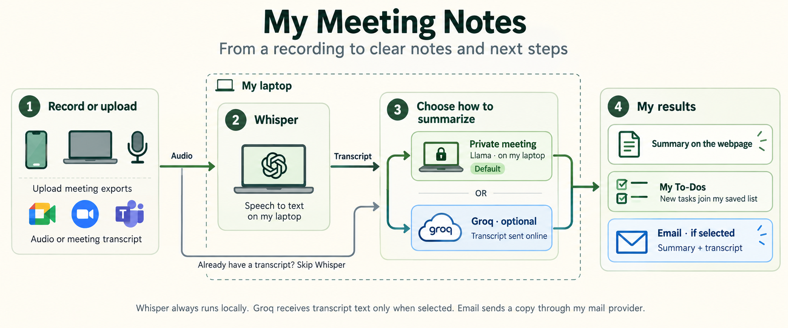

# Personal AI Summarizer

A laptop-hosted webpage for recording or uploading audio, local Whisper transcription, local Ollama summaries, and optional automatic email. Works with desktop, phone, and iPad browsers. No hosted AI API is required.

Whisper and private Llama processing run on your laptop. The optional Groq branch runs online, despite appearing inside the laptop outline in this illustration.

## Windows setup

1. Install Python 3.11 or 3.12 from python.org with **Add Python to PATH** enabled. Install/start Ollama and download a text model if none is installed.
2. Open PowerShell in this folder and run `./setup.ps1`.
3. Edit `.env`: set SMTP settings and `MAIL_TO` for email. Gmail requires an app password where supported; never put your normal password into source code. Leave email unchecked if you have not configured it.
4. Run `./start.ps1` and open http://localhost:8000 on the laptop. The summarizer connects automatically. Record or upload, and create a summary.

The first recording downloads the Whisper model and needs internet. Later transcription runs locally. The default base model uses CPU/int8; larger models improve accuracy but use more resources. Ollama must stay running. Email requires internet.

The app has no login or password. Anyone who can reach its address can use it; keep it on your trusted private network.

## Phone / iPad access

For uploads on the same Wi-Fi, open `http://YOUR-LAPTOP-IP:8000`. Find the laptop's Wi-Fi IPv4 address using `ipconfig`. Windows may ask you to allow the server on private networks.

**Browser microphone recording on a phone or iPad requires a trusted HTTPS address.** A private HTTPS reverse proxy or a private VPN with HTTPS serving can forward to localhost:8000. Until configured, use the device's voice recorder and upload the file. Localhost recording on the laptop works without HTTPS. Do not forward this port directly to the public internet. Plain HTTP on Wi-Fi does not encrypt your recordings; use HTTPS for private content.

## Results and email

Under **Process this meeting**, **Private meeting — Llama on my laptop** is the default. Optional **Groq — online** sends transcript text for summaries and task extraction; Whisper audio processing and To-Dos storage remain local. Add your own `GROQ_API_KEY` to `.env` and restart to enable it. The default cloud model is configured by `GROQ_MODEL`. Keys stay on the laptop and are never returned to the webpage. Provider failures do not trigger automatic switching. Email is independent: uncheck email if a private meeting should stay out of your mailbox.

The personal **My Meeting Notes** page includes a shared **My To-Dos** list saved in `data/todos.sqlite3` on your laptop. New summaries automatically extract tasks and append them without clearing existing items. Each imported task needs a matching transcript quote. Identical task/owner/deadline combinations are deduplicated. You can add tasks manually, mark them complete, and reopen completed tasks. The list is shared across devices accessing the same laptop and survives restarts. Review AI-extracted tasks for mistakes. Existing summaries are not imported retroactively. Email starts checked when configured; uncheck it for a meeting you do not want emailed.

Choose **Meeting transcript** under **What am I adding?** to paste text or upload a UTF-8 `.txt`, `.md`, `.vtt`, or `.srt` file. Transcripts go straight to the selected provider without Whisper. The same on-page results, downloads, and optional email apply. Limit: 500,000 characters (uploaded text files up to 2 MB).

The page shows progress, the transcript, summary, and email delivery status. Copy the summary or download both as a text file. Email sends the summary with a transcript attachment only when the checkbox is enabled. Failed email does not remove the result.

Completed results are saved as JSON in `data/`. Raw audio is deleted after processing, including after failures. Delete JSON files when you no longer need them. Processing is sequential to keep laptop memory use bounded. Upload limit is 100 MB. Long recordings receive separate summaries per transcript chunk. Jobs require the laptop to remain awake and the server running; interrupted jobs do not automatically resume. This is a personal-use first version, without multiple-user accounts or a background Windows service.
